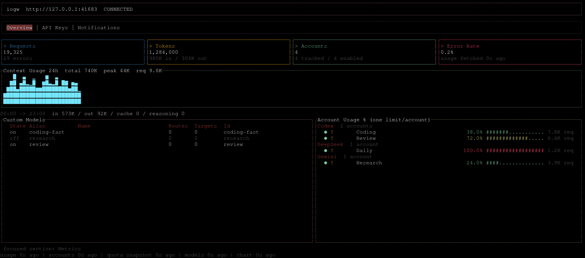
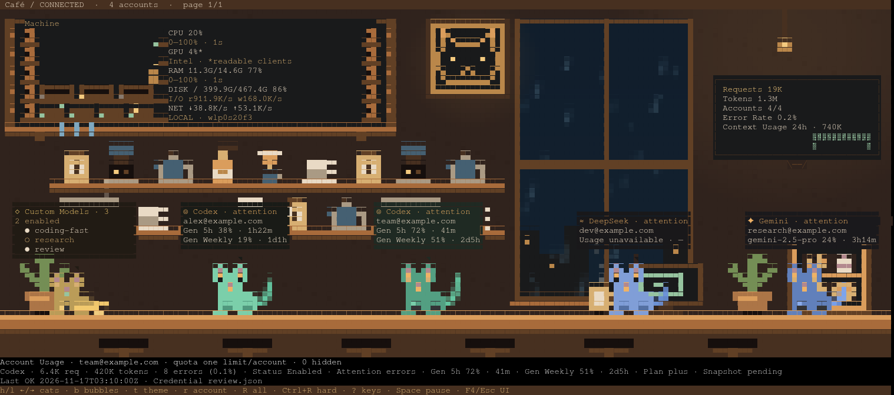
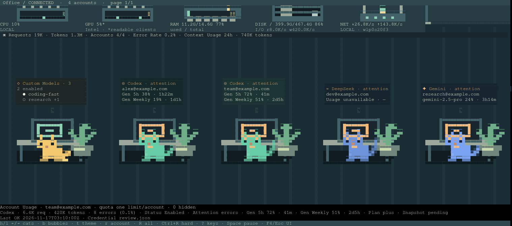
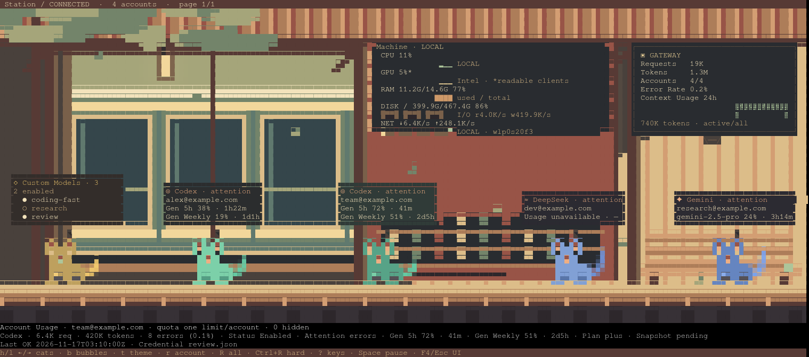

# IO Gateway

One local gateway for Codex CLI, Claude Code, and OpenAI-compatible clients. Connect built-in providers or custom OpenAI-compatible and Anthropic-compatible APIs, share traffic across accounts, and manage everything from a web dashboard or terminal.

[Website](https://gateway.giofahreza.com) · [Documentation](https://gateway.giofahreza.com/docs/) · [Releases](https://github.com/giofahreza/io-gateway/releases)

## A look inside

| Normal terminal UI | Optional Pixel Café theme |
| --- | --- |
| [](site/assets/iogw-tui.png) | [](site/assets/iogw-pixel-cafe.png) |

Actual TUI captures with demo accounts. Click an image for full size. The normal UI needs no theme packs; animated scenes are optional.

<details>
<summary>More themes: Pixel Office and Pixel Station</summary>

| Pixel Office | Pixel Station |
| --- | --- |
| [](site/assets/iogw-pixel-office.png) | [](site/assets/iogw-pixel-station.png) |

</details>

[Explore the themes and installation guide →](https://gateway.giofahreza.com/docs/terminal-ui/)

## Highlights

- One API for OpenAI Responses, Chat Completions, and Anthropic Messages.
- Ten built-in providers, plus tested compatible services including Qwen Coding Plan and NVIDIA.
- Add, view, edit, enable, disable, and delete custom OpenAI-compatible and Anthropic-compatible APIs from the web UI or TUI.
- Multi-account load balancing, priority routing, failover, and custom model aliases.
- Account quotas, usage history, scoped API keys, and notifications.
- Keyboard-driven terminal management with optional animated cat themes.

## Supported providers

| Built-in provider | Model prefix |
| --- | --- |
| OpenAI Codex | `cod:` |
| Anthropic Claude | `cld:` |
| Google Gemini | `gem:` |
| Antigravity | `agw:` |
| Qwen Chat | `qwn:` |
| DeepSeek | `dsk:` |
| MiniMax | `min:` |
| Grok | `grk:` |
| GitHub Copilot | `cop:` |
| GLM / Z.AI | `glm:` |

Connect additional services with the **Compatible API** account type:

| Service or API | Connection |
| --- | --- |
| Qwen Cloud Token Plan (tested) | OpenAI-compatible and Anthropic-compatible APIs; console credits and quota windows |
| Qwen Cloud Pay-as-you-go | OpenAI-compatible and Anthropic-compatible APIs; console account balance and credit limit |
| NVIDIA (tested) | OpenAI-compatible API |
| Custom OpenAI-Compatible API | Your base URL, API key, and Chat Completions model IDs |
| Custom Anthropic-Compatible API | Your base URL, API key, and Messages model IDs |

Compatible accounts use `cmp:<upstream-model-id>`, for example `cmp:qwen3.7-plus`. Configure either format or both in one account. Fetch models when the service supports discovery, or enter model IDs manually. Use `ctm:` aliases to route across providers and compatible accounts.

Select **Qwen Cloud Token Plan** or **Qwen Cloud Pay-as-you-go** in the web account menu, or options **12/13** in the TUI account picker. The editor fills the matching endpoints. In the web UI, choose **Connect Qwen Cloud account** in the Token Plan or Pay-as-you-go add/edit window. In the TUI, choose **c** when editing a Qwen account. **Optional to show quota**: the API key works without connecting. Sign in to the account that owns the key; reconnect when the management login expires. A console Cookie remains available as an advanced alternative. Existing Qwen Cloud compatible accounts retain their IDs and `cmp:` routing. See [Qwen Cloud setup](docs/compatible-apis.md#qwen-cloud-token-plan-and-pay-as-you-go).

[Compatible API setup for the web UI and TUI →](docs/compatible-apis.md)

## Install

Linux and macOS:

```sh
bash -c 'set -o pipefail; curl -fsSL https://github.com/giofahreza/io-gateway/releases/latest/download/install.sh | sh'
```

Windows PowerShell:

```powershell
irm https://github.com/giofahreza/io-gateway/releases/latest/download/install.ps1 | iex
```

No Rust, Docker, or administrator access required. The installer verifies checksums and preserves existing configuration on upgrade.

1. Choose a port, whether to install the `iogw` terminal client, autostart, and whether to start now.
2. Once running, open `http://127.0.0.1:8319/` (or your chosen port) and add a provider account.
3. [Connect your client](https://gateway.giofahreza.com/docs/first-client-request/).

Keep the gateway local until [administrator authentication](https://gateway.giofahreza.com/docs/configuration/) is configured.

[Full installation guide](https://gateway.giofahreza.com/docs/quick-start/) — supported platforms, unattended setup, and source builds.

## Terminal UI

Select `iogw` during installation, reopen your terminal if needed, then run:

```sh
iogw
```

The normal management UI opens first and needs no theme packs. Optional **Café**, **Office**, and **Station** packs add an animated overview using the same client and account controls. After installing a compatible pack, press **F4** or **Ctrl+V** to switch views.

Packs are separate, data-only downloads—not another app or installer. Older releases may not include animation support or packs; the guide explains release availability and the source-build option. Motion is decorative, not proof of account activity.

[See the normal UI and all themes, installation, controls, and remote access →](https://gateway.giofahreza.com/docs/terminal-ui/)

## Documentation

The [website](https://gateway.giofahreza.com) has previews and the complete user guides:

- [Accounts and provider login](https://gateway.giofahreza.com/docs/provider-accounts/)
- [Routing and models](https://gateway.giofahreza.com/docs/routing-and-models/) · [Custom models](https://gateway.giofahreza.com/docs/custom-models/)
- [Compatible APIs](docs/compatible-apis.md) · [API keys](https://gateway.giofahreza.com/docs/api-keys/) · [Usage and quotas](https://gateway.giofahreza.com/docs/usage-and-quota/)
- [Deployment](https://gateway.giofahreza.com/docs/deployment/) · [Troubleshooting](https://gateway.giofahreza.com/docs/troubleshooting/)

A running gateway also serves Swagger at `/docs/` and OpenAPI at `/api-docs/openapi.json`.

## Development

See the [source-build guide](https://gateway.giofahreza.com/docs/quick-start/#build-from-source) and [repository operator reference](docs/operator-guide.md).

```sh
cargo fmt --check
cargo test --locked
cargo build --release --locked
```
